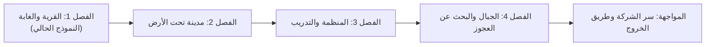

# خاتم الزمن — وثيقة تصميم اللعبة (GDD مختصرة)

## الفكرة في سطر
شاب ملول يدخل "لعبة" تَعِده بحياة جديدة، فيكتشف أن **كل ساعة في الواقع = سنة داخل اللعبة**، وأن خاتمه يحمل قوة **التحكم في الزمن** — وهي أخطر قوة في هذا العالم.

## النوع والمرجع
- أكشن RPG بمنظور الشخص الثالث (Souls-like مخفف) — عالم مفتوح على مناطق.
- المراجع: Elden Ring (الاستكشاف والزعماء)، Prince of Persia: Sands of Time (التلاعب بالزمن)، Sword Art Online (الحبس داخل لعبة).

## الشخصيات
| الشخصية | الدور | فكرة أسلوب اللعب |
|---|---|---|
| **راضي** | البطل، 18 سنة داخل اللعبة | سيف الزمن، إيقاف/إبطاء/ترجيع الزمن |
| **خالد** | فتاة من "ليل القمر" دخلت كرجل منذ 10 سنوات (يوم واحد بالواقع) — هي "الفتاة المختفية" في الأخبار | يستدعي درعًا ورمحًا من العدم |
| **الرجل المسن** | صديق خالد، يحس بالخطر عن بعد | تاجر / نقطة حفظ |
| **العجوز عند الجبل** | المعلّم المجهول — اسم الجبل لغز | هدف رئيسي للفصل الثاني |
| **صاحب المعطف الأسود** | مدير "الشركة" | الشرير الخفي / الزعيم الأخير؟ |
| **الحراس** | جنود النظام، يطاردون الخواتم المحرّمة | أعداء عاديون ونخبة |

## أنظمة اللعب الأساسية
1. **قوة الزمن (المحور):** شريط طاقة ⏳ — إيقاف (مُنفّذ في النموذج)، ثم لاحقًا: إبطاء، ترجيع 3 ثوانٍ، تسريع ذاتي.
2. **القتال:** هجوم خفيف/ثقيل، تفادي بإطار حصانة، صدّ، كسر هجوم العدو.
3. **الخواتم:** كل خاتم = قدرة (خالد أعطى راضي خاتمًا ثانيًا ← فكرة "تجميع الخواتم" كنظام تطوير).
4. **الوقت الحقيقي مقابل وقت اللعبة:** ساعة لعب داخلية تتقدم؛ أحداث تتغير مع "السنين".
5. **المنظمة السرية** في مدينة تحت الأرض: شجرة مهارات وتدريب.

## خريطة الفصول المقترحة

## الطريق للنسخة الاحترافية
| المرحلة | الأداة | ملاحظات |
|---|---|---|
| النموذج الأولي (تم) | متصفح + Three.js | لاختبار الفكرة والإحساس |
| لعبة حقيقية | **Unreal Engine 5** (مجاني) | أفضل رسوميات شبيهة بإلدن رينج، يدعم يد التحكم |
| بديل أخف | Unity أو Godot | أسهل للتعلم وللفريق الصغير |
| الشخصيات والحركات | Mixamo, MetaHuman, Blender | مجانية |
| أنمي/رسوم متحركة | Blender + Storyboard من المشاهد | الرواية مكتوبة بالفعل بأسلوب مشاهد 🎬 |
